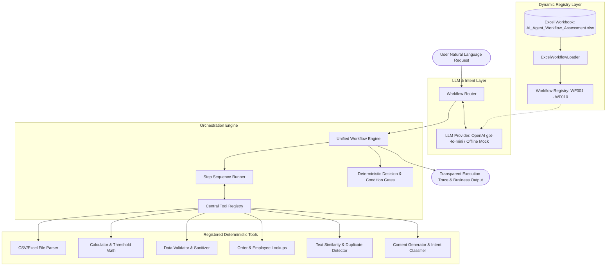

# ⚡ AI Agent Workflow Automation System

[](https://www.python.org/downloads/)
[-success.svg)](https://docs.pytest.org/)
[](https://opensource.org/licenses/MIT)
[](https://streamlit.io/)

> An enterprise-grade, extensible AI Agent workflow automation engine built in Python. Understands natural-language requests, dynamically loads and maps business workflows from Excel, coordinates deterministic tools, executes ordered steps, handles conditions/error states, and returns structured execution traces.

---

## 1. Project Overview & Problem Statement

This project satisfies the technical evaluation assignment: **AI Agent Workflow Automation**.

### Assignment Objective
Convert **10 distinct business workflows** specified in an Excel workbook (`AI_Agent_Workflow_Assessment (1).xlsx`) into an autonomous AI agent system capable of:
1. **Understanding** natural-language requests from users.
2. **Identifying & Routing** to the appropriate business workflow from the Excel source.
3. **Executing** ordered workflow steps sequentially.
4. **Evaluating** business conditions, thresholds, and escalations deterministically.
5. **Handling Errors** gracefully (missing inputs, ambiguous queries, absent records, tool failures).
6. **Displaying** a transparent execution trace:
   - Selected Workflow ID and Name
   - Steps Executed with individual statuses
   - Tools & APIs Invoked
   - Conditions & Decisions Evaluated
   - Final User-Facing & Structured Result

### Critical Architecture Requirement
> **"Do NOT build 10 separate hard-coded chatbots.**  
> **Build a reusable and scalable agent/workflow architecture where adding an 11th workflow requires minimal code changes."**

This system adheres strictly to this requirement: workflows are **data configurations** loaded dynamically from the Excel source into an extensible execution engine. Adding an 11th workflow (`WF011`) requires only adding a row to Excel and registering any novel tool function, without modifying existing workflows.

---

## 2. System Architecture



### Execution Lifecycle
1. **Request Ingestion:** The user submits an unstructured request via CLI, Web UI, or API.
2. **Intent Analysis & Routing:** The `WorkflowRouter` inspects available workflows loaded from Excel. The LLM extracts parameters, evaluates confidence, and flags any ambiguity.
3. **Precondition & Schema Gate:** Mandatory parameters are verified. Missing critical inputs (e.g., campaign dates in WF007) pause execution with `NEEDS_INPUT`.
4. **Step-by-Step Execution:** The `WorkflowEngine` executes ordered steps. Tools are dispatched through the central `ToolRegistry`.
5. **Deterministic Condition Evaluation:** Threshold comparisons, percentage calculations, and escalations run in pure Python (avoiding LLM calculation errors).
6. **Trace Compilation:** A `WorkflowExecutionResult` Pydantic model captures timing, step statuses, tool invocations, condition branches, and the final business summary.

---

## 3. Technology Choices & Justification

| Component | Technology | Rationale |
| :--- | :--- | :--- |
| **Language** | Python 3.11+ | Enterprise standard for AI engineering, strong typing, mature data tooling. |
| **Excel Parser** | `openpyxl` | Robust parsing of `.xlsx` without requiring Excel or heavyweight dependencies. |
| **Schemas** | `pydantic` v2 | Type validation for workflow definitions, routing results, steps, and outputs. |
| **Execution Engine** | Modular Python Engine | Zero vendor lock-in, complete visibility into execution traces, zero latency overhead compared to heavy graph state-machines. |
| **LLM Provider** | Pluggable (OpenAI `gpt-4o-mini` + Offline Mock) | Fast, cost-efficient structured JSON routing; includes deterministic mock mode for 100% offline testability. |
| **User Interface** | `streamlit` | Clean, interactive web dashboard for demonstrations and Loom recordings. |
| **CLI Runner** | Python `argparse` | Lightweight terminal runner for automated benchmarking and scripting. |
| **Testing** | `pytest` | Industry-standard automated test runner with fixtures and verbose assertion reporting. |

---

## 4. The 10 Implemented Workflows

All 10 business workflows are loaded directly from `AI_Agent_Workflow_Assessment (1).xlsx`:

| ID | Workflow Name | Trigger | Inputs | Key Steps | Decision Logic / Conditions | Registered Tools |
| :---: | :--- | :--- | :--- | :--- | :--- | :--- |
| **WF001** | **Inventory Restock Check** | User asks which products need restocking | Inventory CSV; minimum threshold | Load inventory → Compare stock with threshold → Identify low stock → Calculate reorder qty → Generate restock list | If `current_stock < minimum_stock`, mark for restock | `csv_reader`, `calculator`, `check_inventory_restock` |
| **WF002** | **Product Price Validation** | User asks to validate product prices | Internal price CSV; Vendor price CSV | Load prices → Match SKUs → Compare prices → Calculate % variance → Flag exceptions | Flag when price difference exceeds `10%` | `csv_reader`, `calculator`, `validate_product_prices` |
| **WF003** | **Vendor File Processing** | User provides a vendor file for processing | CSV/XLSX vendor feed | Read file → Detect columns → Normalize names → Validate fields → Identify invalid rows → Produce cleaned dataset | Rows missing `SKU` or `product_name` are invalid | `file_parser`, `data_validator`, `process_vendor_file` |
| **WF004** | **Product Description Generator** | User asks to generate product content | Product name, category, material, color, audience | Validate attributes → Create description → Generate short description → Create SEO title → Generate meta description | Do not invent missing attributes; mark as `[Not Specified]` | `text_validation`, `llm_generator`, `generate_product_content` |
| **WF005** | **Customer Order Status** | User asks for order status | Order ID (e.g. `ORD-1001`) or customer email | Validate identifier → Search order store → Retrieve status → Retrieve shipment info → Summarize status | If order not found, ask for another identifier | `order_database`, `shipment_tracker`, `lookup_order_status` |
| **WF006** | **Duplicate Product Detection** | User asks to find duplicate products | Product catalog CSV | Load products → Normalize names/SKUs → Compare identifiers → Compare attributes → Group duplicates → Assign confidence | Exact SKU match = Definite (100%); high attribute overlap = Possible duplicate | `csv_reader`, `text_similarity`, `detect_duplicate_products` |
| **WF007** | **Marketing Campaign Brief** | User asks to create a campaign brief | Campaign goal, product list, audience, promotion, dates | Validate inputs → Identify objective → Summarize products → Create messaging → Channel recommendations → Launch checklist | If `campaign_goal` or `dates` missing, prompt user before generating | `input_validator`, `llm_generator`, `generate_marketing_brief` |
| **WF008** | **SEO Keyword Classification** | User uploads/provides a keyword list | Keyword CSV; taxonomy mapping | Read keywords → Remove duplicates → Classify search intent → Map to categories → Identify high-priority → Export report | Classify into: `Informational`, `Commercial`, `Transactional`, `Navigational` | `csv_reader`, `intent_classifier`, `classify_seo_keywords` |
| **WF009** | **Employee Task Assignment** | Manager asks to assign a task | Task description, skills, workload, priority, deadline | Parse requirements → Compare skills → Check workload → Rank candidates → Select employee → Generate assignment summary | Prefer required skills & lowest workload; **escalate** if no suitable candidate | `employee_database`, `ranking_logic`, `assign_employee_task` |
| **WF010** | **Workflow Performance Report** | User asks for a performance report | Workflow execution logs | Load execution logs → Compute success/failure rate → Compute avg duration → Identify frequent errors → Identify slow steps → Recommendations | Flag workflows with failure rate `> 10%` or avg duration `> 5.0s` | `csv_reader`, `calculator`, `aggregate_workflow_performance` |

---

## 5. Tool & API Inventory

The system maintains a decoupled `ToolRegistry` with 12 reusable tools:
1. `read_csv`: Ingests tabular CSV records into dictionary objects.
2. `process_vendor_file`: Normalizes unstandardized vendor column headers and isolates malformed records.
3. `check_inventory_restock`: Computes inventory levels against safety buffers and calculates reorder quantities.
4. `validate_product_prices`: Matches cross-catalog SKUs and detects variance anomalies above threshold.
5. `generate_product_content`: Generates ecommerce copy, SEO titles (<60 chars), and meta descriptions (<160 chars) without hallucination.
6. `lookup_order_status`: Queries simulated customer fulfillment and logistics tracking data.
7. `lookup_employee_roster`: Ingests team profiles, skill competencies, and active workloads.
8. `detect_duplicate_products`: Hybrid string sequence matcher and token overlap detector for catalog deduplication.
9. `generate_marketing_brief`: Synthesizes omnichannel promotional briefs, messaging pillars, and launch checklists.
10. `classify_seo_keywords`: Deduplicates keyword feeds and maps search intent to site architecture landing pages.
11. `assign_employee_task`: Computes candidate ranking scores `(skill_match * 25) + available_capacity` with manager escalation.
12. `aggregate_workflow_performance`: Evaluates execution logs, computes failure percentages, and flags SLA bottlenecks.

---

## 6. Data Sources & Simulation Disclosures

Because no auxiliary data files were provided with the assignment workbook, realistic synthetic datasets were constructed in `data/`:
* `data/AI_Agent_Workflow_Assessment (1).xlsx`: **Original provided assessment workbook** containing `Workflows` and `Test_Questions` sheets.
* `data/inventory.csv`: Product catalog with current and minimum safety stock levels (WF001).
* `data/internal_prices.csv` & `data/vendor_prices.csv`: Cross-catalog pricing feeds with variance outliers (WF002).
* `data/vendor_raw_feed.csv`: Raw vendor spreadsheet with non-standard headers and missing SKU/name records (WF003).
* `data/orders_database.json`: JSON order fulfillment and FedEx/UPS tracking database (WF005).
* `data/product_catalog.csv`: Catalog with exact SKU duplicates and near-match listings (WF006).
* `data/keywords.csv`: Search keywords with search volume and cost-per-click metrics (WF008).
* `data/employees.json`: Engineering roster with skills, active task counts, and workload percentages (WF009).
* `data/execution_logs.csv`: Historical telemetry recording successes, step latencies, and error codes (WF010).

---

## 7. Repository Structure

```
d:\10workflow\
├── .env.example              # Environment variables template
├── .gitignore                # Git ignore patterns
├── README.md                 # Complete system documentation
├── requirements.txt          # Python dependencies
├── app.py                    # Streamlit interactive web dashboard
├── cli.py                    # Command-line interface and benchmark runner
├── data/                     # Excel workbook and synthetic datasets
│   ├── AI_Agent_Workflow_Assessment (1).xlsx
│   ├── inventory.csv
│   ├── internal_prices.csv
│   ├── vendor_prices.csv
│   ├── vendor_raw_feed.csv
│   ├── orders_database.json
│   ├── product_catalog.csv
│   ├── keywords.csv
│   ├── employees.json
│   └── execution_logs.csv
├── src/                      # Core application source code
│   ├── __init__.py
│   ├── config.py             # Configuration & environment loader
│   ├── schemas.py            # Pydantic models for workflows, steps, results
│   ├── loader.py             # ExcelWorkflowLoader
│   ├── router.py             # WorkflowRouter
│   ├── engine.py             # Unified WorkflowEngine
│   ├── llm/                  # Pluggable LLM provider subsystem
│   │   ├── __init__.py
│   │   ├── base.py           # BaseLLMProvider interface
│   │   ├── mock_provider.py  # Deterministic offline mock provider
│   │   ├── openai_provider.py# Live OpenAI provider
│   │   └── factory.py        # LLM factory
│   └── tools/                # Registered tool implementations
│       ├── __init__.py
│       ├── registry.py       # ToolRegistry
│       ├── file_tools.py     # File parsing & vendor cleansing
│       ├── math_tools.py     # Inventory math, price variance, log analytics
│       ├── lookup_tools.py   # Orders & employee lookups
│       ├── similarity_tools.py# Text similarity & duplicate clustering
│       ├── content_tools.py  # Product copy & marketing briefs
│       ├── classification_tools.py # Search intent classification
│       └── ranking_tools.py  # Candidate task assignment & capacity ranking
├── tests/                    # Automated pytest test suite (20 tests)
│   ├── __init__.py
│   ├── test_all_10_workflows.py # Tests covering all 10 workbook questions
│   ├── test_edge_cases.py    # Missing inputs, boundary cases, escalations
│   └── test_wf011_extension.py# Verification of 11th workflow extensibility
└── loom/
    └── LOOM_SCRIPT.md        # Step-by-step video presentation plan & script
```

---

## 8. Installation & Setup Instructions

### Prerequisites
* **Python 3.10+** (Tested on Python 3.11.9)
* Git

### Step 1: Clone or Navigate to Repository
```bash
git clone https://github.com/harjeetdhiman/ai-agent-workflow-automation.git
cd ai-agent-workflow-automation
```

### Step 2: Create and Activate a Virtual Environment
**On Windows:**
```powershell
python -m venv venv
.\venv\Scripts\Activate.ps1
```
**On Linux / macOS:**
```bash
python3 -m venv venv
source venv/bin/activate
```

### Step 3: Install Dependencies
```bash
pip install -r requirements.txt
```

### Step 4: Configure Environment Variables
Copy the example environment file:
```bash
cp .env.example .env
```
*(Optional)* Add your OpenAI API key to `.env` if you wish to run live LLM routing. If no key is provided, the system defaults automatically to the deterministic offline provider, allowing **100% free offline evaluation**.

---

## 9. Running the Application

### Option A: Interactive Command-Line Interface (CLI)
To run the automated benchmark across all 10 Excel test questions:
```bash
python cli.py --benchmark
```

To run a single custom request:
```bash
python cli.py --query "Which products need restocking?"
```

To start the interactive prompt loop:
```bash
python cli.py
```

### Option B: Interactive Streamlit Web Dashboard
Launch the visual web application:
```powershell
python -m streamlit run app.py
```
*(Or simply double-click / run `.\run_app.bat`)*
Open `http://localhost:8501` in your browser to inspect the loaded Excel registry, select test questions, view step-by-step progress, and test live 11th workflow extensibility.

---

## 10. Automated Testing

Run the full automated test suite using `pytest`:
```bash
python -m pytest tests/ -v
```

### Test Coverage Summary:
* **`tests/test_all_10_workflows.py` (11 tests):**
  - `test_excel_loader_integrity`: Verifies dynamic loading of all 10 workflows and test questions.
  - `test_wf001` through `test_wf010`: Verifies execution, correct step sequences, tool invocations, and output schemas for each workbook test question.
* **`tests/test_edge_cases.py` (8 tests):**
  - Out-of-scope / unsupported queries (clean rejection without crashing).
  - Ambiguous requests (triggers clarification prompt).
  - Missing order lookup (`ORD-9999` returns prompt for valid ID).
  - Missing campaign inputs gate (halts with `NEEDS_INPUT`).
  - Task assignment when no employee has required skills (escalates to manager).
  - Task assignment when all qualified employees are at 100% capacity (escalates to manager).
  - Inventory threshold boundary (current stock == threshold excluded).
  - Price variance boundary (exact 10.0% variance).
* **`tests/test_wf011_extension.py` (1 test):**
  - Live registration and execution of an 11th workflow without regressions.

**Result: 20 passed in ~1.26 seconds.**

---

## 11. How to Add an 11th Workflow

Adding an 11th workflow (e.g., `WF011: Customer Churn Risk Alert`) requires **minimal code changes** because the architecture is declarative and registry-driven:

```python
# Step 1: Add row to Excel 'Workflows' sheet (or define WorkflowDefinition in code)
wf011 = WorkflowDefinition(
    workflow_id="WF011",
    workflow_name="Customer Churn Risk Alert",
    trigger="User asks to identify customer accounts at risk of churning",
    inputs="Customer usage metrics CSV; inactivity threshold",
    steps_raw="Load usage data → calculate inactivity duration → check churn threshold → identify high-risk accounts → generate retention alert",
    steps=["Load usage data", "Calculate inactivity duration", "Check churn threshold", "Identify high-risk accounts", "Generate retention alert"],
    decision_logic="If days_inactive > 30 and engagement_drop > 50%, flag account as high churn risk",
    tools_required=["csv_reader", "calculator", "churn_analyzer"],
    expected_output="List of high-risk customer accounts with retention recommendations"
)
workflow_loader._workflows["WF011"] = wf011

# Step 2: Register any novel tool function needed (if existing tools don't already cover it)
@tool_registry.register("churn_analyzer")
def analyze_churn(inactivity_threshold_days=30):
    return {"high_risk_accounts": [...]}

# Step 3: Register workflow handler in the engine
workflow_engine.register_handler("WF011", exec_wf011_handler)
```
Existing workflows `WF001` through `WF010` remain untouched and continue executing normally.

---

## 12. Security & Reliability Considerations

* **Secrets Hygiene:** No credentials or API keys are committed. All secrets are read via environment variables.
* **Deterministic Calculations:** All financial percentages, threshold checks, and rankings are calculated in pure Python to eliminate LLM arithmetic hallucinations.
* **Input Sanitization:** Identifiers, filenames, and parameters are validated against Pydantic schemas.
* **Least Privilege:** Tools only read authorized paths within the workspace.
* **Resilient Routing:** If the LLM produces an unrecognized workflow ID, the router rejects it rather than executing an erroneous workflow.

---

## 13. Submission Deliverables

As requested by the assignment (Two Links Required):
1. **GitHub Repository:** [https://github.com/harjeetdhiman/ai-agent-workflow-automation](https://github.com/harjeetdhiman/ai-agent-workflow-automation)
2. **Loom Video:** Demonstrates the actual running application, architecture, dynamic Excel loading, tool invocations, condition handling, and 11th workflow extension using `loom/LOOM_SCRIPT.md`.
